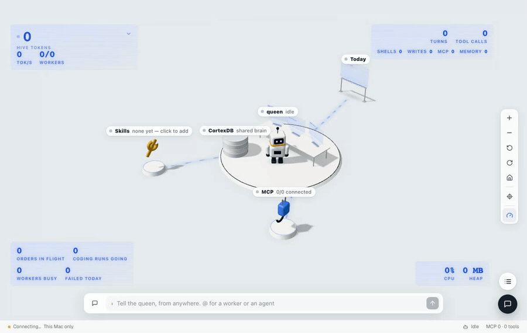
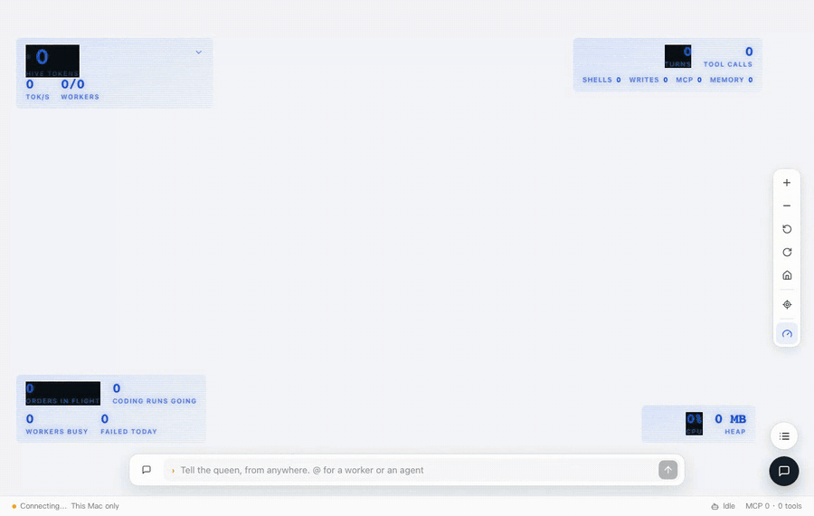

# SuperAI

Your own AI assistant. Talk to it from your phone, your computer or a browser. It remembers what you tell it, keeps your schedule and reminds you, and can put the coding tools on your machines to work for you.

| Chat | iPhone |
|---|---|
|  |  |

## What's in it

- **Core** — the assistant itself. It runs on one machine you leave on, and everything else talks to it.
- **Apps** — the web page the core serves, the desktop app for macOS and Windows, and the iPhone app.
- **Agents** — install SuperAI on your other machines and the core can use Claude Code, Codex and the other coding tools there.
- **Hive** — for more power, run several cores together: one queen takes your request and splits it, and workers do the parts at the same time.

## How to use it

1. **Download** from [Releases](https://github.com/liliang-cn/superai/releases): `SuperAI.dmg` for a Mac (open it and drag SuperAI into Applications), or `SuperAI-Setup.exe` for Windows (run it; Windows may warn first, as the installer is not signed yet).
2. **Open SuperAI.** It asks whether it may look for the AI agents on your computer. If Claude Code is signed in, say yes to use it: no key to paste, no model to pick. If not, sign in with your Claude, Codex or Gemini account in Settings, or enter an API key.
3. **Talk to it.** Ask questions, give it to-dos, set reminders and alarms, or ask it to get something done on one of your machines.

The iPhone app is coming to the App Store.
